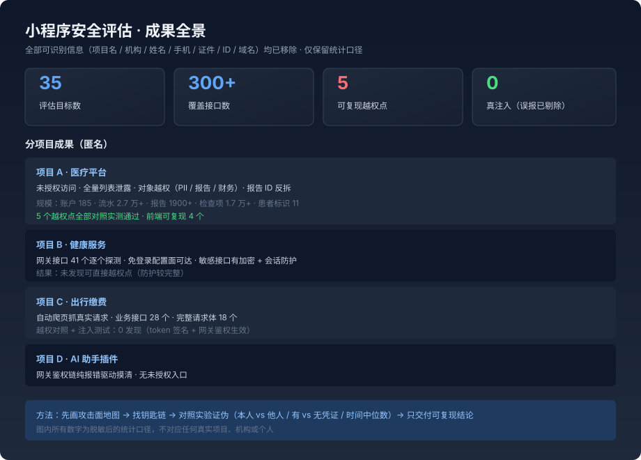

# STRIKE — AI 驱动的小程序安全评估编排层

> 把「小程序动态分析工具链」与「AI 自主思考」组合起来的一套开源方法论与编排框架。
> **大脑是当前 AI 会话的大模型**——不依赖外部 LLM，不需要额外 API key；工具只负责执行。

[](LICENSE)

## 成果示意（已脱敏）



> 按测试类型展示覆盖与结论；不含任何具体平台、目标、机构、姓名或域名，仅为脱敏统计口径。

---

## 它解决什么问题

传统扫描器对小程序攻击面常常「测不全、误报多、复现难」：

- 只扫前端抓到的接口，漏掉后台 API；
- 无脑 fuzz，把接口超时、JSON 回显当成漏洞；
- 报告写了漏洞，但复现步骤对不上真实抓包。

STRIKE 的做法：**对话中的 AI 当大脑做判断，工具链只做执行**；一次给标，全自动把「反编译 → 接口提取 → 全端点探测 → 对照验证 → 报告」跑完，并且只写能复现的结论。

---

## 核心设计

```
        会话大模型（大脑）
      ┌───────┼───────┐
    观察     假设     决策
      └───────┼───────┘
         每次 1-2 个原子调用
     ┌────────┴────────┐
  STRIKE 编排层 (strike.py)
     │                 │
 小程序分析工具       通用后端
 (反编译/CDP/hook)   (资产/发现/报告)
```

- **不调用外部 LLM**：思考由当前会话模型完成，零额外 key 成本。
- **对照实验是唯一判据**：本人 vs 他人 ID、有 vs 无凭证、base vs payload 的时间中位数。
- **全自动推进**：`engage` 一次授权，`auto` 一次跑完，中途不打断用户。
- **只写可复现结论**：前端抓不到的接口如实标注，不编造复现路径。

---

## 目录结构

```
.
├── strike.py                    # 统一编排入口（全自动）
├── strike.config.example.json   # 配置模板（路径/凭据全部可配，无硬编码）
├── AGENT.md                     # AI 助手行为铁律（进程常驻 / 行动偏好 / 证据标准）
├── e0e1-wx/                     # 小程序分析 MCP 工具包（miniapp-security-core skill）
├── scripts/                     # 启动/连接/守护脚本（start_full_chain.py 等）
├── WMPFDebugger/                # 调试注入器（运行时依赖 frida/node_modules 首次安装时拉取）
├── docs/, tools/                # 文档与辅助工具
├── tools/sanitize_check.py      # 提交前脱敏自检
├── .gitignore                   # 严格排除 token / PII / 抓包产物 / 运行时依赖
└── LICENSE                      # GPL-2.0
```

---

## 快速开始

### 1. 前置条件

- Python 3.10+
- 微信开发者工具 / 运行环境的小程序调试支持（工具链自带安装脚本）
- 已获得**明确授权**的目标小程序

### 2. 配置

```bash
cp strike.config.example.json strike.config.json
# 按本机环境填写 WMP-pentest-automation 路径等
# 也可以用环境变量：STRIKE_WMP_ROOT / STRIKE_ARTEX_CTL / STRIKE_MCP_TOKEN
```

### 3. 启动工具链

```bash
cd WMP-pentest-automation
# Windows: 双击 02-一键启动.bat
# 或: python scripts/start_full_chain.py
```

确认端口监听：`9421`（调试）、`62000`（CDP）、`49999`（MCP）。

### 4. 运行 STRIKE

```bash
python strike.py status                          # 查看各后端状态
python strike.py engage                          # 一次授权（写本地标志）
python strike.py auto <appid> --domain <网关域名>  # 全自动跑完
python strike.py report                          # 归档报告
```

全自动流程包含：反编译 → 全量扫描 → 从源码提取接口清单 → 逐个构造请求探测 → 越权对照 + 注入测试 → 结果归档。

---

## 方法论要点

1. **先画地图**：给每个接口标注认证要求、对象参数、数据敏感度、前端可达性。
2. **找钥匙链**：批量泄露 ID 的接口 → 接受该 ID 的接口 → 换 ID 越权 → 反拆更深层 ID 放大。
3. **对照验证**：没有对照的「漏洞」一律不采信。
4. **可复现优先**：宁可少报，不报复现不了的点。
5. **进程常驻**：任务结束不退出服务，避免反复重开的成本。

详见 [`AGENT.md`](AGENT.md)，以及脱敏后的
[`验证方法论与成果口径`](docs/验证方法论与成果口径.md)（对照实验设计、签名场景动态测试路线、敏感度与定级原则）。

---

## 可控调试链路（Web 控制台）

`tools/web-console/` 提供一个零依赖本地 Web 面板，用来可控地启动/停止 CDP 调试链路：
点按钮完成「启动 / 停止 / 退出」，全程无窗、无后台守护拉起多份、精确 PID 管理。
配套无窗 Frida 注入器，避免旧方案反复弹窗与端口冲突（Errno 10048）。

```bash
python tools/web-console/server.py        # 默认 127.0.0.1:47821
# 浏览器打开 http://127.0.0.1:47821/
```

详见 [`tools/web-console/README.md`](tools/web-console/README.md)。

---

## 安全与合规

- 本项目仅用于**已获授权**的安全评估、CTF、防御性研究。
- 使用者须自行确保对目标拥有合法授权，并遵守所在地法律法规。
- 项目**不包含**任何真实 token、账号、受害者数据或具体目标清单；示例均为占位符。
- 提交前请运行脱敏自检：

```bash
python tools/sanitize_check.py
```

---

## 许可

本项目采用 **GNU GPL-2.0**（见 [LICENSE](LICENSE)）。使用、修改、分发请遵守该许可条款。

---

## 致谢

本项目的小程序动态分析能力建立在 [WMP-pentest-automation](https://github.com/hello-xiaoniao/WMP-pentest-automation) 之上——该项目解决了微信小程序更新后偏移值变化导致的注入失败问题，是整套工具链的基础。感谢原作者的开源贡献。

同时感谢所有开源组件与安全社区对自动化安全评估方法的贡献。
